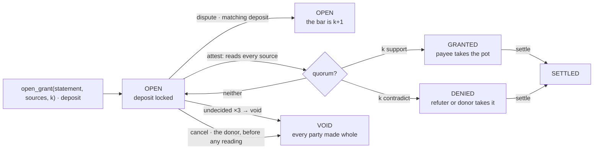

# Quorum

**A grant released only when a quorum of independent sources agrees.**

One donor locks a grant behind one statement and a frozen list of independent
pages. No single page decides it: the committee reads every page once, and the
grant is released only when at least `threshold` of them back the statement. A
refusal is symmetric — the same threshold of pages contradicting it returns the
grant to the donor.

No oracle, no single source, no arbiter: a page is one count in a quorum, and a
page whose quote cannot be grounded in it does not count at all.

## Why it is a different contract

Three things here are not in the usual "an AI reads a page" contract:

- **No one source decides anything.** The committee reads every source in one
  non-deterministic block, and the whole decision is two bit strings — one bit
  per source. A single page cannot grant or refuse a grant, so a page that has
  been bought, rewritten or played cannot move the money on its own.
- **A dispute raises the bar instead of re-reading.** A stranger who believes the
  quorum is wrong matches the deposit, and the quorum that settles the grant
  becomes one page wider. The sources are never re-chosen and the question is
  never re-aimed, so a clear quorum survives a frivolous dispute and a thin one
  cannot be forced through.
- **Money always has an exit.** A grant nobody disputed can be cancelled by its
  donor, a grant no quorum reached can be voided by anyone once the attempts are
  spent, and every exit returns each party its own money.

## Live on GenLayer Studio

`deployment.json` is the single source of truth: the **Deploy Contract** workflow
deploys the register once, writes the file, and commits it back to `main`.

| | |
|---|---|
| **Contract** | _recorded by the Deploy Contract workflow_ |
| **Network** | GenLayer Studio — chainId `61999` (`0xf22f`), test GEN only |
| **Evidence** | [Actions](https://github.com/weels007/genlayer-quorum/actions) — direct, Studio, money paths, every deployment |

The address is checked against this repository: `scripts/verify_deployment.py`
compares the recorded `revision` — the first twelve characters of the SHA-256 of
`contracts/Quorum.py`, written by the deploy script — with the checkout, and both
live suites refuse to run when the two disagree. A register with no owner cannot
be upgraded, so the address and the source have to be provably the same thing.

## Lifecycle



## How a reading is produced

| Step | What happens |
|---|---|
| **Open** | A statement (10–300 chars), 2–4 distinct `https` sources, a quorum of at least two of them, a payee, and a caller-scoped reference. All of it is frozen here, and the deposit is locked. |
| **Dispute** | A stranger matches the deposit and raises the quorum by one. Nothing is fetched here, and nothing is re-chosen: only the bar moves. |
| **Read** | `attest` fetches every source inside one non-deterministic block, capped at `MAX_PAGE_CHARS` each, and the model answers `SUPPORTS`, `CONTRADICTS` or `SILENT` per source with a verbatim quote from that source. |
| **Ground** | Each quote must appear in its own source after folding to letters and digits. A source whose quote cannot be grounded does not count: it is silence, not a guess. |
| **Consensus** | Validators re-run every fetch and every prompt and must produce the same two bit strings — one bit per source. Disagreement writes nothing. The quotes and digests are descriptive, and no later call reads them. |
| **Decide** | The quorum is counted from the bits, never from prose: `k` supports grants, `k` contradictions denies, and anything else books an attempt without moving money. |
| **Settle** | The payee takes the deposit plus a forfeited dispute stake, or the refuter takes its stake plus the deposit, or the donor takes its own deposit back when nobody disputed a denial. |

### Error taxonomy

| Tag | Meaning | Consensus behaviour |
|---|---|---|
| `[EXPECTED]` | bad input, wrong caller, wrong stake, a grant in the wrong state | deterministic, must match |
| `[EXTERNAL]` | a source is empty | deterministic, recorded |
| `[TRANSIENT]` | network / 5xx, a source unreachable | both transient means agreement, retry |
| `[LLM_ERROR]` | a model response that is not JSON at all | always disagrees → new leader |

A reading the committee cannot parse is **not a count**: an unreadable or
ambiguous answer is silence for that source, and a quote that cannot be grounded
in its own page is silence too. Neither reverts anything, because a revert would
roll the attempt back and a grant nobody can read could never be voided.

## Money rules

Value enters as the donor's deposit and, if the grant is disputed, as the
refuter's matching stake, and it leaves in exactly three ways.

- **`open_grant` and `dispute` never revert once value is attached.** A refused
  call — a deposit below the floor or above the cap, a bad statement, a bad source
  list, a bad quorum, a bad payee, a stake that does not match, a self-dispute, or
  a grant with no wider quorum to raise — becomes a **credit** owned by the sender,
  withdrawable with `withdraw_credit`.
- **The quorum pays the payee**, and a denial pays the refuter when one disputed
  it. A denial nobody disputed sends the deposit back to the donor.
- **Every exit is whole.** `cancel` returns the donor's deposit, and `void`
  returns the deposit and the dispute stake to their own parties.
- **The ledger is updated first and the transfer last**, so a failed transfer
  rolls both back together. Before paying out, the contract checks both the ledger
  and the real balance.

Invariant: `total_in == total_out + locked_total`, credits included.

## Contract API

**Write**

| Method | Who | Purpose |
|---|---|---|
| `open_grant(statement, sources, threshold, payee, grant_ref)` · payable | anyone | lock a grant behind a quorum of sources |
| `dispute(grant_id)` · payable | anyone but the donor | match the deposit and raise the quorum by one |
| `attest(grant_id)` | anyone | read every source once and count the quorum |
| `settle(grant_id)` | anyone | pay the pot to whoever the quorum decided for |
| `void(grant_id)` | anyone | make every party whole when no quorum was reached |
| `cancel(grant_id)` | the donor | take back a grant before it is read |
| `withdraw_credit()` | anyone with a credit | take back money from a refused call |

**View**

| Method | Returns |
|---|---|
| `get_grant(id)` · `get_grants()` · `get_grant_ids()` | a grant, all grants, the id list |
| `get_reading(id)` | the two bit strings, with one quote and one digest per source |
| `is_disputed(id)` | whether a stranger raised the bar |
| `get_credit(address)` · `get_ledger()` · `get_balance()` | credits, `total_in`, `total_out`, `locked_total`, real balance |
| `get_summary()` · `get_rules()` | counters, and the bounds the contract enforces |

## Security review

| Risk | How Quorum answers it |
|---|---|
| One page deciding a grant | A quorum is never one page (`MIN_THRESHOLD` is 2), and the decision is the count of independent bits. |
| A leader counting a page it did not read | Validators fetch every source and re-derive both bit strings themselves, and only the bits are compared. |
| A source whose quote is not in it | Its quote has to appear in its own page, and a source that cannot ground one is silence — so a hallucinated support cannot count towards a quorum. |
| Moving the goalposts | The statement, the sources and the payee are written once by `open_grant` and never edited. |
| A dispute that re-reads the sources or re-aims the question | `dispute` fetches nothing and names nothing; it only raises the bar by one, and it is refused when no wider quorum is available. |
| A leader picking the evidence the money follows | The bits are the only fields compared, and the quotes are descriptive — no later call reads them as a decision. |
| Funds locked forever | `cancel` (by the donor), `void` (by anyone after the attempts), `settle` (by anyone after a decision), and `withdraw_credit` (for a refused call) are all exits. |
| Any account moving somebody else's money | Payouts go to the stored parties — the payee, the refuter, or the donor — and `cancel` is refused for anyone else. |
| A model answering in prose | The answer is read as whole words; a negated or ambiguous answer is unread rather than guessed. |
| SSRF through a source | `https` only, no IP literal, no single-label host, no metadata aliases, alphabetic TLD. |
| Replay opening a second grant | The reference is caller-scoped and recorded once. |
| Unbounded work | 500 grants, 4 sources, 3 attempts per grant, capped strings, O(1) summary. |

Residual risks, stated plainly:

- **A quorum is only as good as its sources.** A page that backs a statement for
  the wrong reason still counts, because the contract checks that the sentence is
  in the page, not that the page is right. Two of three is a majority, not a proof.
- **A page that changes while the committee reads it cannot be counted.** Two
  validators that read different text produce different bits, consensus writes
  nothing, and the grant books an attempt instead of settling on a reading nobody
  agreed on. Three attempts, and anyone may void it.
- **Test GEN only.** There is no mainnet path, no audited token, and the caps keep
  a demo bounded rather than being economic parameters.

## Testing

| Suite | What it covers | Run |
|---|---|---|
| **Direct** | opening, every refusal, the quorum, the per-source grounding, the wider bar after a dispute, the denial, the void and the ledger invariant | `pytest tests/direct -v` |
| **Studio** | the deployed register: a real grant, a live quorum of three sources, a dispute that raises the bar, a grant nobody could read that is voided, and the settlement, with the payout checked twice — the ledger moves and the contract's real balance falls | `pytest tests/integration -v -s` |
| **End to end** | the money paths without a model: a deposit below the floor, a duplicate reference, a self-payee, a stake that does not match, a dispute with no wider bar, a stranger cancelling, and an unearned settle or void | `pytest tests/e2e -v -s` |

Every assertion in the live suites is a delta, and every reference carries the
run's start time, so they can be re-run against the same register.

## Quick start

```bash
pip install -r requirements.txt

genvm-lint check contracts/Quorum.py   # forbidden imports, storage, nondet misuse
pytest tests/direct -v                 # the whole register, in memory, milliseconds
pytest tests/integration -v -s         # the deployed register, live
pytest tests/e2e -v -s                 # the deployed register's money paths

python scripts/deploy.py               # deploy once, record deployment.json
python scripts/verify_deployment.py    # the address on file is this source
```

The direct suite mocks every source and the model; the quorum, the per-source
grounding, the wider bar and every refund are exercised in memory.

The live suites sign with throwaway Studio accounts that the repository keeps in
Actions secrets — one donor and one stranger — so no key material is committed.

## Layout

```text
contracts/Quorum.py              the register
tests/direct/                     opening, readings, consensus, views
tests/integration/                the deployed register, live
tests/e2e/                        the deployed register's money paths
testdata/supports.txt            a page that backs the statement
testdata/contradicts.txt         a page that contradicts it
testdata/ungroundable.txt        a page no quote can be grounded in
scripts/deploy.py                deploys once, records deployment.json
scripts/verify_deployment.py     the address on file is this contract
scripts/wallet.py                keystore from tests/ or a repository secret
deployment.json                  the deployed address (written by the workflow)
.github/workflows/               ci, live, deploy-contract
SUBMISSION.md                    the short pack for a reviewer
```

## Submission

[`SUBMISSION.md`](SUBMISSION.md) is the short pack for a reviewer: what the
contract is, the deployed facts, what each suite proves, and the limits that are
still true. Every public method — seven writes and ten views — is exercised
against the deployed address; the Studio suite and the money paths are the evidence.

`python scripts/verify_deployment.py` proves the address and the source are the same
thing, which is the one claim a reviewer cannot check from the contract alone.

## License

[MIT](LICENSE).
